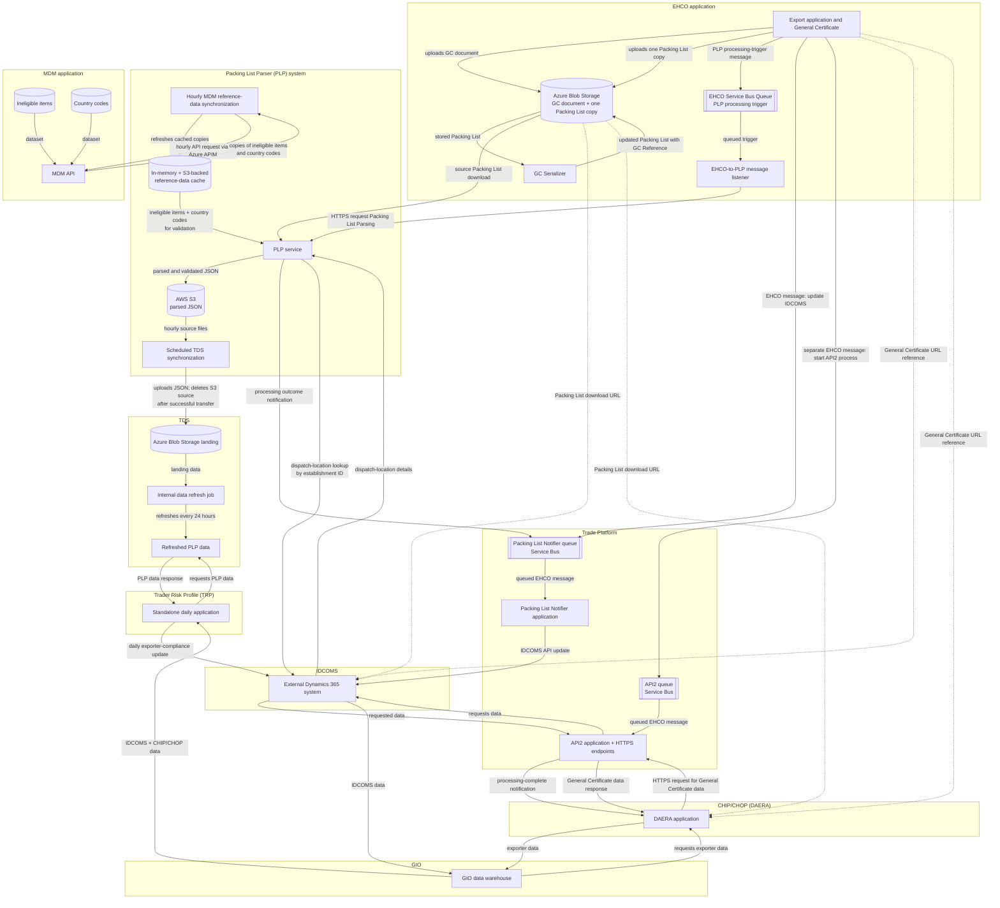

# Packing List End-to-End Journey

## Purpose

This document describes the wider journey of a packing list through the trade
exports environment. It starts with an Export application in EHCO, includes
the Packing List Parser (PLP) processing boundary, and ends with the result
being available to IDCOMS and structured data being synchronized to TDS. It
also shows how Trader Risk Profile (TRP) uses this and other data to update
IDCOMS daily with exporter compliance information.

The detailed parsing and validation steps are documented in the
[Packing List Process](../packing-list-process/source.md). This page focuses
on the systems around that process. EHCO, API2, IDCOMS, GIO and TRP
interactions below combine the supplied business description with the PLP
integration documented in this repository; the two sources are distinguished
in the diagram note.

## Journey at a glance

> **Diagram note:** Each enclosing box is an application/system boundary;
> the nodes inside are its components. Labels on solid connectors describe
> messages, API calls, files or data returned. Dashed connectors show document
> URL references rather than document transfers. EHCO, Trade Platform, MDM,
> IDCOMS, DAERA, GIO and TRP details come from supplied business context;
> PLP's API, MDM, S3 and TDS integrations are documented in this repository.

## Stages

1. **Create the Export application and General Certificate in EHCO.** EHCO
   creates the certificate and uploads its document to EHCO Blob Storage.
   The General Certificate URL is shared with consuming applications.
2. **Store and update the Packing List.** EHCO uploads one Packing List copy
   to its Blob Storage. The GC Serializer updates that stored file with the
   Export application's GC Reference. EHCO shares a download URL with
   consuming applications.
3. **Start the two Trade Platform processes.** EHCO sends separate messages
   to the Trade Platform Service Bus queues:
   - The Packing List Notifier queue message is processed by the Packing List
     Notifier application, which updates IDCOMS through its APIs.
   - The API2 queue message starts API2 processing. API2 retrieves data from
     IDCOMS, notifies DAERA when processing is complete, and serves General
     Certificate data through HTTPS endpoints when requested by DAERA.
4. **Trigger PLP processing.** An EHCO-side message listener consumes the
   PLP processing trigger from the EHCO Service Bus Queue and sends an HTTPS
   request to PLP. The documented endpoint is `POST /process-packing-list`,
   with an `application_id`, `packing_list_blob` URI and an IDCOMS
   establishment identifier.
5. **Download and process the source document.** PLP downloads the file from
   EHCO Blob Storage, resolves dispatch location information using IDCOMS,
   discovers a parser, extracts product lines and applies business
   validations. The detailed flow and outcomes are in
   [Packing List Process](../packing-list-process/source.md).
   PLP sends processing-result notifications through the Trade Platform
   Service Bus to Packing List Notifier, which updates IDCOMS through its APIs.
   This operational result-update route is separate from the S3/TDS/TRP
   analytics and risk-assessment flow below. Notifications can be disabled;
   unrecognised `NOMATCH` outcomes are not notified.
6. **Refresh MDM reference data.** PLP downloads copies of the ineligible
   items and country-codes datasets from the MDM API through Azure APIM every
   hour. It caches the data in memory and S3 for validation.
7. **Persist and transfer structured data.** PLP writes parsed JSON to AWS
   S3. Its scheduled synchronization transfers the files to TDS Azure Blob
   Storage hourly; after a successful transfer, the source file is removed
   from S3.
8. **Refresh TDS data.** A separate job within TDS refreshes its data every
   24 hours.
9. **Update exporter risk information.** TRP is a standalone application
   that runs once a day. It receives IDCOMS data through GIO, requests
   exporter data from CHIP/CHOP through GIO, and requests PLP data from TDS
   before updating IDCOMS with exporter compliance information.
10. **View results and supporting documents.** IDCOMS presents processing
    results to users. Consuming applications use the General Certificate URL
    reference and Packing List download URL to access EHCO documents.
