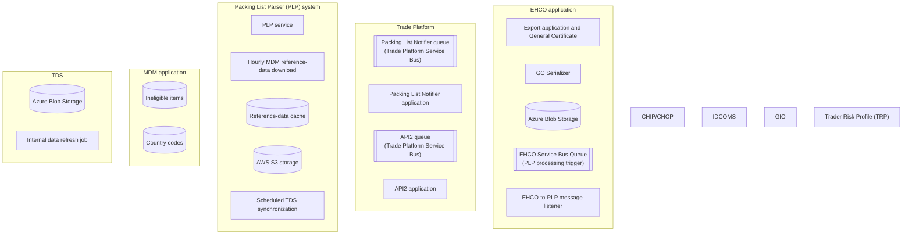

# Systems and Data in the Packing List Journey

This page summarizes the systems involved in the wider journey. The EHCO,
API2, Northern Ireland, IDCOMS, GIO and TRP descriptions come from the
supplied business context; their interfaces are not documented in this PLP
repository. MDM data ownership comes from the supplied context. PLP integration
details, including its MDM API integration, are drawn from the repository's
[system context](../C4-SYSTEM-CONTEXT.md) and
[canonical process description](../packing-list-process/source.md).

## System boundaries and responsibilities

The diagram distinguishes application boundaries from the components and
communication channels inside them. It shows containment only; the
inter-system data flows are listed in [Data hand-offs](#data-hand-offs).

| System boundary               | Element                            | Element type                          | Role in the journey                                                                                                                                                                                                                                                                                                    | Data or interaction                                                                                                                                                                                 | Evidence / status                                                                                                                                                                                                                |
| ----------------------------- | ---------------------------------- | ------------------------------------- | ---------------------------------------------------------------------------------------------------------------------------------------------------------------------------------------------------------------------------------------------------------------------------------------------------------------------- | --------------------------------------------------------------------------------------------------------------------------------------------------------------------------------------------------- | -------------------------------------------------------------------------------------------------------------------------------------------------------------------------------------------------------------------------------- |
| **EHCO**                      | EHCO application                   | Application                           | Creates the Export application and General Certificate, uploads the GC document and one Packing List copy, and initiates processing through its Service Bus Queue. The application's GC Reference is added at the top of the Packing List. EHCO provides download links when either document is referenced through it. | Export application, GC URL, Packing List Blob URL and processing-trigger message.                                                                                                                   | Supplied business context; exact download-link behavior is not detailed.                                                                                                                                                         |
| **EHCO**                      | GC Serializer                      | Application component                 | Updates the Packing List stored in EHCO Blob Storage.                                                                                                                                                                                                                                                                  | Updated Packing List at its Blob URL.                                                                                                                                                               | Supplied business context.                                                                                                                                                                                                       |
| **EHCO**                      | Azure Blob Storage                 | Data store                            | Stores the General Certificate document and one copy of the Packing List within EHCO.                                                                                                                                                                                                                                  | GC document and Packing List URL, referenced by `packing_list_blob` for PLP.                                                                                                                        | Supplied business context; PLP Blob download is confirmed in [PLP system context](../C4-SYSTEM-CONTEXT.md).                                                                                                                      |
| **EHCO**                      | Service Bus Queue                  | Messaging channel                     | Holds the EHCO processing-trigger message for the EHCO-side listener.                                                                                                                                                                                                                                                  | Trigger message leading to a PLP request.                                                                                                                                                           | Supplied business context; message schema is not documented here.                                                                                                                                                                |
| **EHCO**                      | EHCO-to-PLP message listener       | Integration component                 | Listens to the EHCO Service Bus Queue and sends an HTTPS request to PLP.                                                                                                                                                                                                                                               | Consumed trigger and outbound `POST /process-packing-list` request.                                                                                                                                 | Supplied business context; exact component name and implementation are not documented here.                                                                                                                                      |
| **Trade Platform**            | Trade Platform                     | Application/platform boundary         | Contains API2, Packing List Notifier and their separate Service Bus queues.                                                                                                                                                                                                                                            | Asynchronous messages for Packing List Notifier and API2 processing; API calls and HTTPS requests between the applications and external systems.                                                    | Supplied business context; component boundaries are not documented in this repository.                                                                                                                                           |
| **Trade Platform**            | Packing List Notifier queue        | Messaging channel (Service Bus queue) | Carries EHCO messages and PLP processing-result notifications for the Packing List Notifier application to process.                                                                                                                                                                                                    | EHCO message or PLP processing-result notification.                                                                                                                                                 | Supplied business context; queue name and message schema are not documented here.                                                                                                                                                |
| **Trade Platform**            | Packing List Notifier              | Application                           | Processes messages from its Trade Platform Service Bus queue and updates IDCOMS through its APIs.                                                                                                                                                                                                                      | EHCO queue messages, PLP processing-result notifications, and API updates to IDCOMS.                                                                                                                | Supplied business context; implementation and message schema are not documented here.                                                                                                                                            |
| **Trade Platform**            | API2 queue                         | Messaging channel (Service Bus queue) | Carries a separate EHCO message that starts API2 processing.                                                                                                                                                                                                                                                           | EHCO processing-trigger message.                                                                                                                                                                    | Supplied business context; queue name and message schema are not documented here.                                                                                                                                                |
| **Trade Platform**            | API2                               | Application and HTTPS API             | Processes its queue message, retrieves data from IDCOMS, and notifies DAERA when processing is complete. It also exposes HTTPS endpoints for DAERA to request General Certificate data.                                                                                                                                | Queue message; data retrieved from IDCOMS; completion notification to DAERA; HTTPS General Certificate data requests and responses.                                                                 | Supplied business context; endpoint and message details are not documented here.                                                                                                                                                 |
| **CHIP/CHOP**                 | CHIP/CHOP                          | External application                  | DAERA application that receives API2 completion notifications, can request General Certificate data from API2, and provides exporter data requested by GIO.                                                                                                                                                            | API2 completion notification; General Certificate data request/response; exporter data returned to GIO on request.                                                                                  | Supplied business context; DAERA is the Department of Agriculture, Environment and Rural Affairs.                                                                                                                                |
| **Packing List Parser (PLP)** | PLP service                        | Application/service                   | Receives the HTTPS request, downloads, parses and validates the Packing List, uses the MDM reference data during validation, persists the result, sends processing-result notifications to Packing List Notifier when enabled, and runs scheduled data synchronizations.                                               | HTTPS `POST /process-packing-list`; source Blob URI; establishment identifier; MDM reference data; parsed result; processing-result notification; scheduled TDS file synchronization.               | Endpoint and processing confirmed in [Packing List Process](../packing-list-process/source.md); MDM integration is confirmed in [PLP system context](../C4-SYSTEM-CONTEXT.md). Unrecognized `NOMATCH` outcomes are not notified. |
| **Packing List Parser (PLP)** | MDM reference-data synchronization | Background process                    | Downloads a copy of each MDM dataset every hour for PLP use.                                                                                                                                                                                                                                                           | Ineligible items and country codes downloaded from MDM.                                                                                                                                             | Confirmed in [PLP system context](../C4-SYSTEM-CONTEXT.md); dataset ownership and hourly copies are supplied business context.                                                                                                   |
| **Packing List Parser (PLP)** | Reference-data cache               | Cache (in-memory and S3-backed)       | Holds the downloaded reference data for PLP validation and across service restarts.                                                                                                                                                                                                                                    | Cached copies of ineligible items and country codes.                                                                                                                                                | Confirmed in [PLP system context](../C4-SYSTEM-CONTEXT.md).                                                                                                                                                                      |
| **Packing List Parser (PLP)** | AWS S3 storage                     | Data store                            | Stores parsed JSON as durable PLP output and provides the source files for TDS synchronization.                                                                                                                                                                                                                        | Parsed result, normally keyed using the application ID.                                                                                                                                             | Confirmed in [PLP system context](../C4-SYSTEM-CONTEXT.md); inside the PLP system boundary.                                                                                                                                      |
| **Packing List Parser (PLP)** | Scheduled TDS synchronization      | Background process                    | Transfers parsed JSON files from PLP's S3 storage to TDS hourly.                                                                                                                                                                                                                                                       | S3 objects uploaded to TDS Azure Blob Storage; successful source files are removed from S3.                                                                                                         | Confirmed in [PLP system context](../C4-SYSTEM-CONTEXT.md).                                                                                                                                                                      |
| **MDM**                       | MDM                                | Application/system boundary           | Stores the ineligible-items and country-codes datasets used by PLP.                                                                                                                                                                                                                                                    | Ineligible items and country codes (ISO codes).                                                                                                                                                     | Dataset ownership is supplied business context; PLP connects through the MDM API via Azure APIM as confirmed in [PLP system context](../C4-SYSTEM-CONTEXT.md).                                                                   |
| **IDCOMS**                    | IDCOMS                             | External Dynamics 365 System          | Resolves dispatch locations for PLP, receives updates from Packing List Notifier, and presents processing results to users, with access to the GC and Packing List in EHCO.                                                                                                                                            | Establishment ID and dispatch-location details; updates from Packing List Notifier; compliance status and reason for failure for exporter-specific model matches and the special `NOREMOS` outcome. | PLP dispatch lookup is confirmed in [PLP system context](../C4-SYSTEM-CONTEXT.md); notifier interaction, system identity and IDCOMS behavior are supplied business context. Unrecognized `NOMATCH` outcomes are not shown.       |
| **TDS**                       | TDS                                | External system                       | Receives structured packing-list data and runs a separate internal job to refresh its data every 24 hours.                                                                                                                                                                                                             | Parsed JSON synchronized from S3 hourly; refreshed PLP data is requested by TRP.                                                                                                                    | Supplied context confirms the deployed schedules; PLP documentation describes the S3-to-TDS transfer.                                                                                                                            |
| **TDS**                       | Azure Blob Storage                 | Data store                            | Receives the PLP files synchronized from S3.                                                                                                                                                                                                                                                                           | Parsed JSON files.                                                                                                                                                                                  | Confirmed in [PLP system context](../C4-SYSTEM-CONTEXT.md).                                                                                                                                                                      |
| **TDS**                       | Internal data refresh job          | Background process                    | Refreshes TDS data independently of the PLP file transfer.                                                                                                                                                                                                                                                             | TDS landing data.                                                                                                                                                                                   | Supplied business context; runs every 24 hours.                                                                                                                                                                                  |
| **GIO**                       | GIO                                | External data platform                | Provides warehouse data used by TRP, including IDCOMS data and data requested from CHIP/CHOP.                                                                                                                                                                                                                          | IDCOMS data and CHIP/CHOP exporter data for the daily TRP run.                                                                                                                                      | Supplied business context; warehouse details are not documented in this repository.                                                                                                                                              |
| **Trader Risk Profile (TRP)** | Trader Risk Profile (TRP)          | Standalone application                | Assesses exporter compliance and updates IDCOMS.                                                                                                                                                                                                                                                                       | IDCOMS and CHIP/CHOP data through GIO; requests PLP data from TDS.                                                                                                                                  | Supplied business context; runs once per day.                                                                                                                                                                                    |

## Data hand-offs

| From                                        | To                                          | Hand-off                                                                      | Timing / condition                                                                                                 |
| ------------------------------------------- | ------------------------------------------- | ----------------------------------------------------------------------------- | ------------------------------------------------------------------------------------------------------------------ |
| EHCO                                        | Trade Platform: Packing List Notifier queue | Message for Packing List Notifier                                             | Starts the notifier's processing to update IDCOMS.                                                                 |
| Trade Platform: Packing List Notifier queue | Trade Platform: Packing List Notifier       | Queued message                                                                | Consumed by the notifier application.                                                                              |
| Trade Platform: Packing List Notifier       | IDCOMS                                      | Update through IDCOMS APIs                                                    | Made while processing an EHCO message or PLP processing-result notification.                                       |
| Packing List Parser (PLP): service          | Trade Platform: Packing List Notifier queue | Processing-result notification                                                | Sent when notifications are enabled; unrecognized `NOMATCH` outcomes are not notified.                             |
| EHCO                                        | Trade Platform: API2 queue                  | API2 processing-trigger message                                               | Starts a separate API2 process.                                                                                    |
| Trade Platform: API2 queue                  | Trade Platform: API2                        | Queued message                                                                | Consumed to start API2 processing.                                                                                 |
| Trade Platform: API2                        | IDCOMS                                      | Data retrieval                                                                | API2 retrieves data from IDCOMS as part of its process.                                                            |
| Trade Platform: API2                        | CHIP/CHOP (DAERA)                           | Processing-complete notification                                              | Sent when API2 completes its process.                                                                              |
| CHIP/CHOP (DAERA)                           | Trade Platform: API2                        | HTTPS request for General Certificate data                                    | DAERA requests the data through API2's HTTPS endpoints.                                                            |
| Trade Platform: API2                        | CHIP/CHOP (DAERA)                           | General Certificate data response                                             | Returned in response to a DAERA request.                                                                           |
| MDM                                         | PLP: MDM reference-data synchronization     | Ineligible-items dataset                                                      | PLP downloads a copy every hour through the MDM API via Azure APIM.                                                |
| MDM                                         | PLP: MDM reference-data synchronization     | Country-codes dataset                                                         | PLP downloads a copy every hour through the MDM API via Azure APIM.                                                |
| PLP: MDM reference-data synchronization     | PLP: reference-data cache                   | Updated reference-data copies                                                 | Loaded for PLP validation and cached in memory and S3.                                                             |
| EHCO                                        | EHCO: Azure Blob Storage                    | General Certificate document and one Packing List copy                        | General Certificate creation uploads its document; EHCO uploads the Packing List, which the GC Serializer updates. |
| EHCO: Azure Blob Storage                    | EHCO: GC Serializer                         | Stored Packing List                                                           | Serializer updates the file in Blob Storage.                                                                       |
| EHCO                                        | IDCOMS and CHIP/CHOP (DAERA)                | General Certificate URL reference and Packing List download URL               | Both applications use these references to access the documents through EHCO.                                       |
| EHCO                                        | EHCO: Service Bus Queue                     | Processing-trigger message                                                    | Consumed by the EHCO-side message listener.                                                                        |
| EHCO: Service Bus Queue                     | EHCO: message listener                      | Processing-trigger message                                                    | Listener consumes the queued message.                                                                              |
| EHCO: message listener                      | Packing List Parser (PLP): service          | HTTPS request with application ID, Packing List Blob URL and establishment ID | PLP documents `POST /process-packing-list`.                                                                        |
| EHCO: Azure Blob Storage                    | Packing List Parser (PLP): service          | Original Packing List file                                                    | Downloaded during request processing.                                                                              |
| Packing List Parser (PLP): service          | IDCOMS                                      | Establishment ID lookup for dispatch-location resolution                      | Per processing request.                                                                                            |
| Packing List Parser (PLP): service          | PLP: AWS S3 storage                         | Parsed and validated JSON                                                     | Internal PLP hand-off; persisted after processing, including no-match outcomes.                                    |
| PLP: AWS S3 storage                         | PLP: scheduled TDS synchronization          | Parsed JSON files                                                             | Internal PLP hand-off to the hourly sync job.                                                                      |
| PLP: scheduled TDS synchronization          | TDS: Azure Blob Storage                     | Parsed JSON files                                                             | Runs hourly; source files are removed from S3 after successful upload.                                             |
| TDS landing data                            | TDS: internal data refresh job              | PLP data refreshed within TDS                                                 | Separate TDS job runs every 24 hours.                                                                              |
| IDCOMS                                      | GIO                                         | IDCOMS data for exporter-compliance assessment                                | Used by TRP through GIO.                                                                                           |
| GIO                                         | CHIP/CHOP                                   | Request for exporter data                                                     | GIO requests this data for the TRP flow.                                                                           |
| CHIP/CHOP                                   | GIO                                         | Requested exporter data                                                       | Returned to GIO for the TRP flow.                                                                                  |
| GIO                                         | TRP                                         | IDCOMS and CHIP/CHOP data                                                     | Used in the daily TRP run.                                                                                         |
| TRP                                         | TDS                                         | Request for PLP data                                                          | Requested by the standalone TRP application in its daily run.                                                      |
| TDS                                         | TRP                                         | Requested PLP data                                                            | Returned to TRP for the daily compliance assessment.                                                               |
| TRP                                         | IDCOMS                                      | Exporter compliance information                                               | Updated once per day.                                                                                              |

## Trade Platform, MDM, PLP and TDS flows

The Trade Platform queue-driven applications, PLP's MDM data downloads and
TDS file synchronization, TDS's internal data refresh, and TRP's TDS data
request are separate flows:

- The **Packing List Notifier flow** starts when EHCO puts a message on the
  Packing List Notifier queue in the Trade Platform Service Bus. PLP also
  sends processing-result notifications to that queue when notifications are
  enabled; unrecognized `NOMATCH` outcomes are not notified. The Packing List
  Notifier application processes these messages and updates IDCOMS through its
  APIs. This result-update route is separate from PLP's S3-to-TDS data flow.
- The **API2 flow** starts from a different EHCO message on the API2 queue.
  API2 retrieves data from IDCOMS, notifies DAERA when its processing is
  complete, and serves General Certificate data through HTTPS endpoints when
  requested by DAERA.
- The **MDM reference-data flow** provides PLP with hourly copies of the
  ineligible-items and country-codes datasets for validation. PLP caches the
  copies in memory and S3.
- The **PLP-to-TDS flow** transfers structured JSON from S3 to TDS on a
  schedule. The deployed schedule is hourly and is part of the PLP system.
- A **separate job within TDS** refreshes TDS data every 24 hours, separately
  from the hourly file transfer.

These distinctions matter when producing a system diagram: show each EHCO
message and its Trade Platform queue separately from the hourly MDM data
downloads, PLP-to-TDS file transfer, TDS's internal 24-hour refresh and TRP's
request for data from TDS.

## TRP daily feedback loop

TRP is a standalone application that combines three data paths once per day
to update IDCOMS with exporter compliance information:

- IDCOMS data reaches TRP through GIO.
- GIO requests exporter data from CHIP/CHOP and provides it to TRP.
- TRP requests PLP data from TDS.

This daily update is separate from the EHCO-triggered Trade Platform
applications, the hourly PLP-to-TDS synchronization and TDS's internal
24-hour data refresh.
