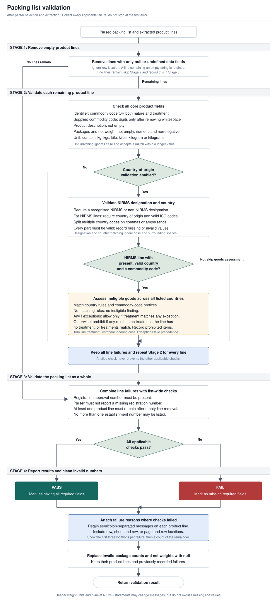

# Packing list validation

[Open the SVG flowchart](./packing-list-validation.svg).

The four validation stages, from extracted product lines to the final result.
See [validation rules](./validation-rules.md) for detailed acceptance rules.
Decisions are green, recorded failures blue, rule notes amber, and final
pass/fail outcomes teal/red, following the ineligible-goods diagram's palette.

## What the Checks Do and Do Not Establish

The chart shows the order in which checks run. It does not mean the service
verifies that every extracted value is correct. These are **failure checks**:
the service records a reason only when an applicable rule is broken; it does
not report a separate success message for each rule. A packing list passes
when all applicable required checks pass and there are no list-wide failures.
A check that was not run is not evidence that the data passed it.

The table below summarises the rules applied to extracted data and the failure
reason generated when each rule fails. Product-line failures are generally
reported with the applicable row, sheet and row, or page and row. Missing
weight units when a header unit is present, and missing NIRMS designations
when a blanket statement is present, are reported as general reasons instead.
Several failures can be reported for the same line.
See the [detailed validation rules](./validation-rules.md#stage-2-validate-each-product-line)
for failure messages, examples and edge cases.

| Check / information          | Rule applied                                                                                                                                                                                                                      | Failure reason generated                                                                                                                                 | What is not validated                                                                                                                                 |
| ---------------------------- | --------------------------------------------------------------------------------------------------------------------------------------------------------------------------------------------------------------------------------- | -------------------------------------------------------------------------------------------------------------------------------------------------------- | ----------------------------------------------------------------------------------------------------------------------------------------------------- |
| Product identifier           | Every retained line must have a commodity code, **or** both nature and treatment.                                                                                                                                                 | `Identifier is missing`                                                                                                                                  | Whether the identifier accurately identifies the goods.                                                                                               |
| Commodity code               | Whenever supplied, contains only digits after whitespace is removed; whitespace-only values pass this format check.                                                                                                               | `Product code is invalid`                                                                                                                                | Required length, existence in a commodity catalogue or consistency with the product description.                                                      |
| Nature of products           | Required when no commodity code is supplied; must be present with treatment.                                                                                                                                                      | `Identifier is missing`                                                                                                                                  | Recognised product categories or accuracy for the goods.                                                                                              |
| Treatment type               | Required when no commodity code is supplied; compared with matching ineligibility rules when that assessment applies.                                                                                                             | `Identifier is missing` when required but empty; `Prohibited item identified on the packing list` when a matching ineligibility rule prohibits the line. | A general list of recognised treatments, spelling, synonyms or evidence that treatment occurred.                                                      |
| Product description          | Every retained line must have a value.                                                                                                                                                                                            | `Product description is missing`                                                                                                                         | Meaningfulness, accuracy or consistency with the commodity code.                                                                                      |
| Number of packages           | Every retained line must be present and convert to a non-negative number.                                                                                                                                                         | `No of packages is missing` or `No of packages is invalid`                                                                                               | A whole-number requirement or reconciliation against document totals.                                                                                 |
| Total net weight             | Every retained line must be present and convert to a non-negative number.                                                                                                                                                         | `Total net weight is missing` or `Total net weight is invalid`                                                                                           | Plausibility or reconciliation against document totals.                                                                                               |
| Net-weight unit              | Every retained line must contain `kg`, `kgs`, `kilo`, `kilos`, `kilogram` or `kilograms`, ignoring case.                                                                                                                          | `Net Weight Unit of Measure (kg) not found`                                                                                                              | Exact unit-name matching or whether the declared unit is correct; matches within longer text are accepted.                                            |
| NIRMS designation            | Every retained line when country validation is enabled must match a recognised NIRMS or non-NIRMS designation.                                                                                                                    | `NIRMS/Non-NIRMS goods not specified` or `Invalid entry for NIRMS/Non-NIRMS goods`                                                                       | Whether the goods actually qualify for the declared designation.                                                                                      |
| Country of origin            | Recognised NIRMS lines when country validation is enabled must have a country; every supplied country code must be in the available ISO list.                                                                                     | `Missing Country of Origin` or `Invalid Country of Origin ISO Code`                                                                                      | Actual origin, or country-code validity on non-NIRMS lines or when validation is disabled.                                                            |
| Ineligible goods             | When country validation is enabled, the line is NIRMS, the country is present and valid, and a commodity code is supplied, apply matching country and commodity-code prefix rules, treatment conditions and exception precedence. | `Prohibited item identified on the packing list`                                                                                                         | Eligibility beyond those rules or accuracy of the declared country, commodity and treatment. Missing prerequisites mean **not assessed**, not passed. |
| Registration approval number | The extracted registration must be present and the parser must not report a missing-RMS outcome.                                                                                                                                  | `Check GB Establishment RMS Number.`                                                                                                                     | This stage does not itself verify registration against an authoritative register.                                                                     |
| Remaining product lines      | At least one product line must remain after empty-line removal.                                                                                                                                                                   | `No product line data found.`                                                                                                                            | Whether every product in the original document was successfully extracted.                                                                            |
| Establishment numbers        | No more than one establishment number may be listed.                                                                                                                                                                              | `Multiple GB Place of Dispatch (Establishment) numbers found on packing list.`                                                                           | This count check does not itself confirm the declared dispatch location is correct.                                                                   |

For presence checks, `null`, `undefined` and `''` are empty, but spaces are
not. The whole list fails if any applicable check fails; an unchecked aspect
of the data is not independently verified by a passing result.

- **Column recognition is not value validation:** finding a "Type of
  Treatment" column identifies where to extract data, not whether its
  contents are recognised treatment names.
- **Treatment has no general recognised-value check:** without a commodity
  code it must be present alongside nature. It is also compared with
  applicable ineligibility rules, ignoring case and surrounding spaces but
  not correcting spelling. See the [worked treatment examples](./validation-rules.md#treatment-type-what-is-and-is-not-validated),
  including how `Chiled` can miss a standard `Chilled` prohibition.
- **Coverage varies by model:** country, NIRMS and ineligibility checks are
  not enabled for every supported template. See the [model coverage table](./validation-rules.md#model-specific-check-coverage).
- **Skipped is not passed:** "not assessed" means a check's prerequisites
  were not met; "not validated" means no check exists for that aspect of the
  data. These are [documentation labels](./validation-rules.md#how-to-read-the-validation-results),
  not extra statuses returned by the service.

## Validation Flow

```mermaid
flowchart TD
    START([Packing list parsed and product lines extracted])

    subgraph S1["Stage 1: Remove empty product lines"]
        FILTER["Remove lines where every data field is null or undefined<br/>Ignore row location; retain lines containing empty strings"]
    end

    subgraph S2["Stage 2: Validate each remaining product line"]
        CORE["Check all core fields; record every failure<br/>Identifier: commodity code OR both nature and treatment<br/>Supplied commodity code: digits only after removing whitespace<br/>Description: not empty<br/>Packages and net weight: not empty, numeric and non-negative<br/>Weight unit: contains kg, kgs, kilo, kilos, kilogram or kilograms"]
        ENABLED{"Country-of-origin<br/>validation enabled?"}
        NIRMS{"Recognised NIRMS<br/>designation supplied?"}
        DESIGNATION["Record missing or invalid NIRMS designation"]
        ISNIRMS{"NIRMS line?"}
        COUNTRY{"Country present and every<br/>supplied ISO code valid?"}
        COUNTRYFAIL["Record missing or invalid country"]
        CODE{"Commodity code supplied?"}
        MATCH{"Any country and commodity-code<br/>prefix rules match?"}
        EXCEPTION{"Any matching exception rules<br/>with treatment beginning with !?"}
        ALLOWED{"Line treatment matches the text<br/>after ! in any matching exception?"}
        STANDARD{"Any standard rule has no treatment,<br/>line treatment is missing,<br/>or treatments match?"}
        PROHIBITED["Record prohibited item"]
        SAVE["Retain all failures for this line<br/>Continue checks even when another check has failed"]
        MORE{"More product lines?"}
    end

    subgraph S3["Stage 3: Validate the packing list as a whole"]
        LIST["Combine line failures with list-wide checks<br/>Registration approval number present<br/>Parser does not report missing registration<br/>At least one product line remains<br/>No more than one establishment number"]
        RESULT{"All applicable checks pass?"}
    end

    subgraph S4["Stage 4: Report results and clean invalid numbers"]
        PASS["PASS<br/>Mark as having all required fields"]
        FAIL["FAIL<br/>Mark as missing required fields<br/>Attach list-wide reasons and affected line locations"]
        REPORT["Retain semicolon-separated line failure messages<br/>Report row, sheet and row, or page and row<br/>For each failure: show up to three locations, then remaining count"]
        CLEAN["Replace invalid package counts and net weights with null<br/>Keep their product lines and previously recorded failures"]
        END([Return validation result])
    end

    START --> FILTER --> CORE --> ENABLED
    FILTER -->|"No lines remain"| LIST
    ENABLED -->|No| SAVE
    ENABLED -->|Yes| NIRMS
    NIRMS -->|No| DESIGNATION --> SAVE
    NIRMS -->|Yes| ISNIRMS
    ISNIRMS -->|No| SAVE
    ISNIRMS -->|Yes| COUNTRY
    COUNTRY -->|No| COUNTRYFAIL --> SAVE
    COUNTRY -->|Yes| CODE
    CODE -->|No| SAVE
    CODE -->|Yes| MATCH
    MATCH -->|No| SAVE
    MATCH -->|Yes| EXCEPTION
    EXCEPTION -->|Yes| ALLOWED
    ALLOWED -->|Yes| SAVE
    ALLOWED -->|No| PROHIBITED
    EXCEPTION -->|No| STANDARD
    STANDARD -->|Yes| PROHIBITED
    STANDARD -->|No| SAVE
    PROHIBITED --> SAVE
    SAVE --> MORE
    MORE -->|Yes| CORE
    MORE -->|No| LIST
    LIST --> RESULT
    RESULT -->|Yes| PASS
    RESULT -->|No| FAIL
    PASS --> REPORT
    FAIL --> REPORT
    REPORT --> CLEAN --> END

    NOTE["A header weight unit or blanket NIRMS statement<br/>can change failure messages, but does not excuse<br/>a missing line-level value"]
    NOTE -.- LIST

    classDef decision fill:#DCE8E0,stroke:#5F8575,color:#1A202C
    classDef process fill:#FFFFFF,stroke:#CBD5E0,color:#1A202C
    classDef finding fill:#E3ECFB,stroke:#5B7FBD,color:#1E3A5F
    classDef note fill:#FDF6E8,stroke:#E0A83E,color:#6B4A1E
    classDef pass fill:#15685F,stroke:#15685F,color:#FFFFFF
    classDef fail fill:#B23A3A,stroke:#B23A3A,color:#FFFFFF
    class ENABLED,NIRMS,ISNIRMS,COUNTRY,CODE,MATCH,EXCEPTION,ALLOWED,STANDARD,MORE,RESULT decision
    class START,FILTER,CORE,SAVE,LIST,REPORT,CLEAN,END process
    class DESIGNATION,COUNTRYFAIL,PROHIBITED finding
    class NOTE note
    class PASS pass
    class FAIL fail
```

## Reading the chart

- **Scope:** validation begins after parser selection and extraction. For Excel
  and CSV, missing recognised GB RMS numbers or unsupported formats can prevent
  parser selection; see [before validation](./validation-rules.md#before-validation-choose-a-parser).
- **Empty values:** required-field checks treat `null`, `undefined` and `''`
  as empty. Spaces are not empty; numeric conversion treats spaces as zero.
  Zero and numeric strings pass the numeric checks.
- **Core checks:** a supplied invalid commodity code fails even if nature and
  treatment are supplied. There is no commodity length or catalogue check.
  Unit matching ignores case and accepts a match within a longer value.
- **Conditional checks:** NIRMS and country checks are mandatory when enabled.
  Country codes on NIRMS lines may be separated by commas or ampersands;
  every part must be valid. A skipped ineligible-goods check does not erase
  other failures or establish eligibility.
- **Ineligible goods:** combine matching rules across all listed countries.
  Exceptions take precedence over standard rules. Treatment comparisons ignore
  case, and the line's treatment is trimmed before comparison.
- **Reference data:** ISO codes use available cached data, otherwise the static
  list. Ineligibility rules use static data unless MDM integration is enabled
  and cached rules are available.
- **Results:** failures are collected, not used to stop validation at the first
  error. Invalid numbers are cleared only after their failures are recorded.
