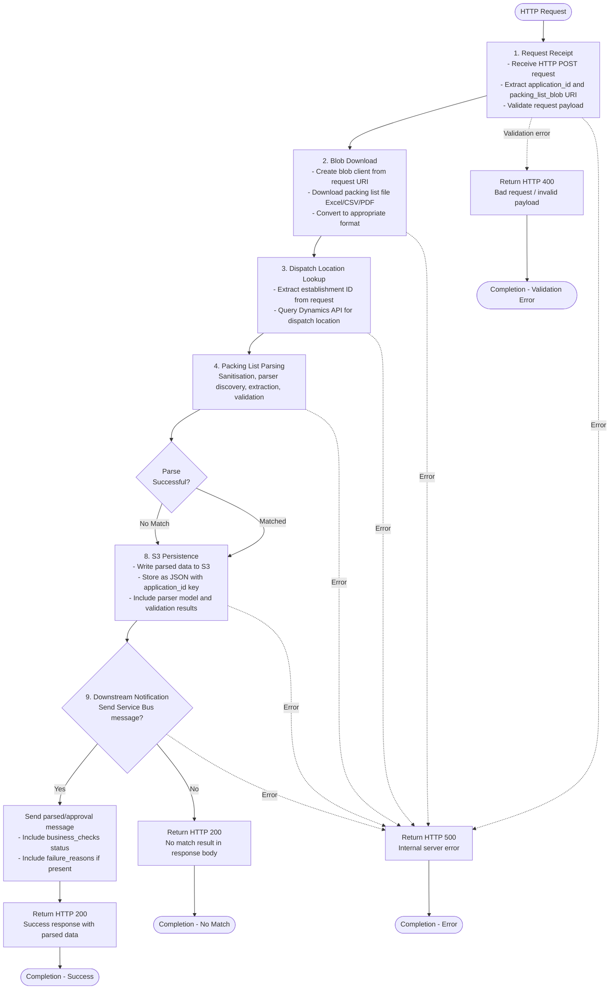
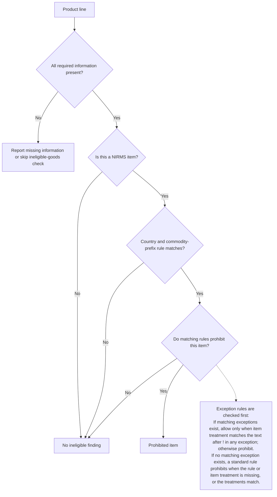

# Packing List Process — Source of Truth

This is the canonical, audience-neutral description of how a packing list is
processed, from HTTP request to completion. [tester.md](./tester.md) and
[developer.md](./developer.md) are derived from this document — update this
file first, then re-align the summaries.

## End-to-End Flow

## Stages at a Glance

| Stage | Name                     | What happens                                                                                        |
| ----- | ------------------------ | --------------------------------------------------------------------------------------------------- |
| 1     | Request receipt          | Validate `application_id`, `packing_list_blob`, and establishment ID are present and well-formed.   |
| 2     | Blob download            | Download the packing list file and convert Excel/CSV to JSON (PDF stays as a buffer).               |
| 3     | Dispatch location lookup | Query dispatch location for the establishment ID.                                                   |
| 4     | Input sanitisation       | Remove trailing spaces and empty cells so parser matching is consistent.                            |
| 5     | Parser discovery         | Identify file type, confirm a GB RMS establishment number is present, then match a retailer format. |
| 6     | Data extraction          | Locate the header row, map columns to standard fields, and extract each product line.               |
| 7     | Validation & cleanup     | Remove empty lines, validate each product line and the packing list as a whole, record failures.    |
| 8     | S3 persistence           | Store the parsed/validated result as JSON, keyed by `application_id`.                               |
| 9     | Downstream notification  | Optionally publish a Service Bus message with the outcome.                                          |

## Outcomes

| Outcome                        | HTTP status | `approvalStatus`                                           | Trigger                                                                                                               |
| ------------------------------ | ----------- | ---------------------------------------------------------- | --------------------------------------------------------------------------------------------------------------------- |
| Matched, all checks pass       | 200         | `approved`                                                 | Parser found and every validation stage passes.                                                                       |
| Matched, validation failed     | 200         | `rejected_ineligible`, `rejected_coo`, or `rejected_other` | Parser found but one or more stages fail; response includes a reason.                                                 |
| No match / unrecognised format | 200         | `rejected_other`                                           | No GB RMS number found (parser model `NOREMOS`), or no retailer parser matches the document (parser model `NOMATCH`). |
| Invalid request                | 400         | —                                                          | Request payload fails shape/field validation (stage 1).                                                               |
| Internal error                 | 500         | —                                                          | Unhandled error in download, lookup, parsing, persistence, or notification.                                           |

Persistence and notification also depend on the outcome: a `NOMATCH` result
is still persisted to S3 but its downstream notification is skipped; a
`NOREMOS` result is persisted and notified as normal. Notification is also
skipped entirely when disabled by configuration or when the caller requests
`stopDataExit`.

## Parser Discovery (Plain Language)

Parser discovery decides which retailer-specific parser (if any) should read
the file:

1. **File type detection** — Excel, CSV, or PDF, based on the file extension.
2. **RMS number check** — the document must contain a GB establishment number
   in the form `RMS-GB-######-###` (six digits, three digits). Without one,
   the result is a missing-RMS outcome.
3. **Retailer matcher loop** — for each known retailer template (for this
   file type), check the establishment number pattern, then the header row
   structure.
4. **Result** — a specific parser (e.g. `ASDA3`, `TESCO3`), or an
   unrecognised-format outcome if no template matches.

See [parser-discovery-extraction-generic.md](./parser-discovery-extraction-generic.md)
for the full step-by-step algorithm, and
[parser-discovery-extraction-detailed.md](./parser-discovery-extraction-detailed.md)
for the per-file-type breakdown with implementation pointers.

## Validation Rules

Once a parser has extracted product lines, each line and the packing list as
a whole are checked against a fixed set of business rules — required fields,
numeric formats, NIRMS/country-of-origin checks, and ineligible-goods
assessment. The full rules, acceptance tables and failure-message reference
are in [validation-rules.md](./validation-rules.md).

### Ineligible Goods Assessment (One Product Line)

This flow assumes country-of-origin validation is enabled and that the NIRMS
designation and country codes have already been validated. It shows the
ineligible-goods assessment for one product line, not the packing list's
overall validation result.

A styled rendering of this diagram is available at
[ineligible-goods-process.svg](./ineligible-goods-process.svg).

Rule types are described in full, with worked examples, in the
["Ineligible Goods" section of validation-rules.md](./validation-rules.md#ineligible-goods).

## Where to Go Next

- Testing against these rules: [tester.md](./tester.md)
- Implementing or extending the service: [developer.md](./developer.md)
